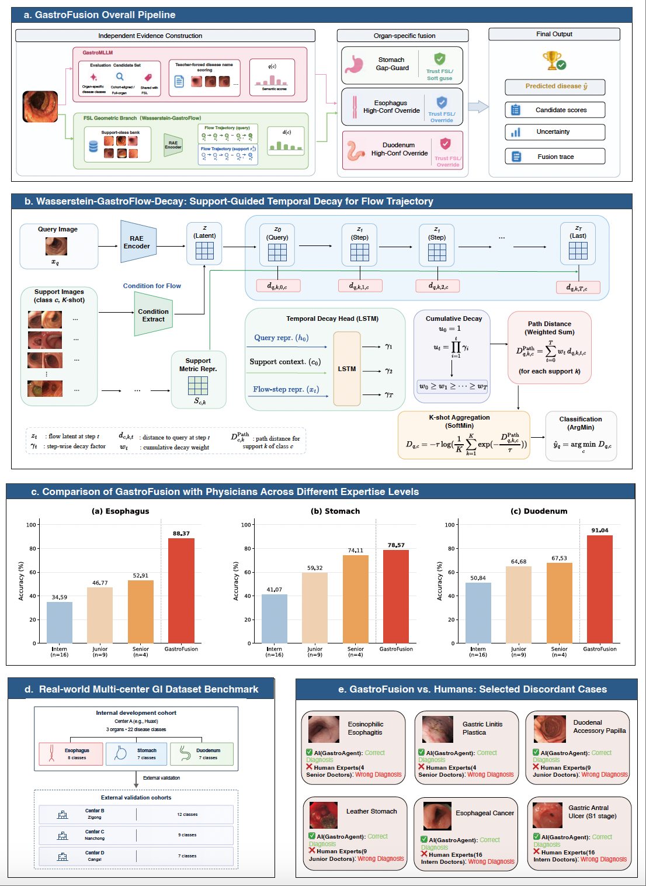
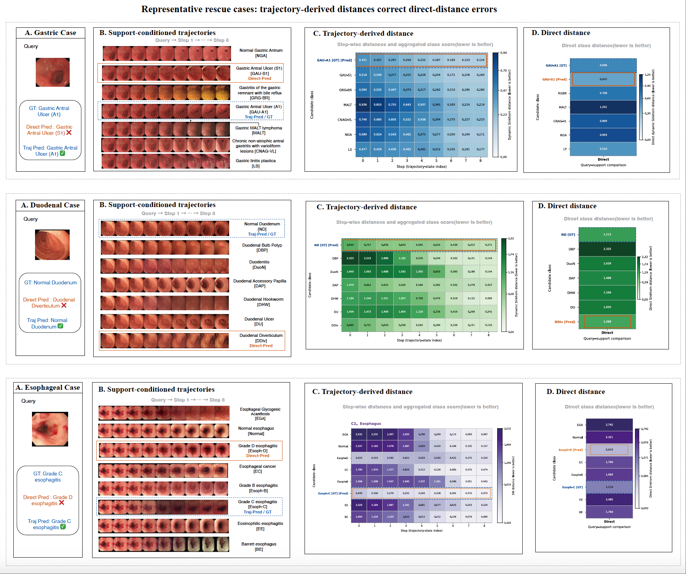

# GastroFusion

[](LICENSE)
[](https://www.python.org/downloads/)
[](https://pytorch.org/)

**Geometry-aware multimodal AI improves few-shot gastrointestinal diagnosis under limited data**

English | [简体中文](README_CN.md)

---

## Contents

- [Overview](#overview)
- [Key Features](#key-features)
- [Changelog](#changelog)
- [System Requirements](#system-requirements)
- [Installation](#installation)
- [Model Weights and Demo Data](#model-weights-and-demo-data)
- [Quick Reproduction Demos](#quick-reproduction-demos)
  - [Demo A — Wasserstein-GastroFlow Inference and Evaluation](#demo-a--wasserstein-gastroflow-inference-and-evaluation)
  - [Demo B — GastroFusion Geometric–Semantic Fusion Inference](#demo-b--gastrofusion-geometricsemantic-fusion-inference)
  - [Baseline Evaluation — Few-Shot and Long-Tail Recognition](#baseline-evaluation--few-shot-and-long-tail-recognition)
- [Training](#training)
- [Project Structure](#project-structure)
- [Visualizations](#visualizations)
- [Citation](#citation)
- [Acknowledgements](#acknowledgements)
- [Data Availability](#data-availability)
- [License](#license)
- [Contact](#contact)

---

## Overview

**GastroFusion** is a multimodal AI framework for upper gastrointestinal endoscopic image diagnosis. It addresses challenges arising from long-tailed disease distributions, limited annotations for rare lesions, and cross-centre data shifts. The framework combines few-shot trajectory-based geometric matching from **Wasserstein-GastroFlow** with medical semantic evidence from **GastroMLLM (Med-Qwen3-VL)**, integrating their predictions through organ-specific fusion rules.

| Core component | Main function |
|---|---|
| **Wasserstein-GastroFlow** | Few-shot matching using support-conditioned latent-space trajectories and Sinkhorn-approximated distributional transport costs. |
| **GastroMLLM (Med-Qwen3-VL)** | A Qwen3-VL-8B-based medically adapted multimodal model providing semantic scores for candidate diagnoses. |
| **GastroFusion fusion module** | Integrates geometric matching and semantic prediction evidence using organ-specific rules. |

**Main experimental findings:**

- **Few-shot baseline comparison:** Across six internal organ–support-protocol settings, all three trajectory scoring schemes achieved higher mean accuracy than eight FSL baselines. The best-performing variant in each setting exceeded the strongest FSL baseline by **10.86–42.00 percentage points** and the strongest long-tail recognition baseline by **1.25–61.18 percentage points** (the latter is a contextual, non-episodic comparison).
- **External validation:** Three independent external centres contributed **352 images across nine centre–organ cohorts**. Relative to DeepEMD, the three trajectory schemes improved macro accuracy by **8.70–10.14 percentage points** with target-domain support and **13.91–19.80 percentage points** with source-domain support.
- **Physician comparison:** On a fixed **166-case** internal WCH reader-study cohort, GastroFusion achieved **86.00%** organ-macro accuracy, compared with **64.85%** for senior endoscopists.
- **Multimodal evaluation:** GastroMLLM achieved **94.99%** accuracy on **OmniMedVQA-GI (1,537 questions)**.
- **Fusion complementarity:** External fusion yielded numerical gains of **1.24** and **0.75 percentage points** under cohort-aligned and full-organ label spaces, respectively. A branch-selection oracle revealed complementary diagnostic coverage between geometric and semantic predictions.



---

## Key Features

- **Few-shot and long-tail diagnosis:** Matches candidate diseases using limited labelled support examples.
- **Trajectory-based geometric matching:** Combines RAE representations, conditional DiT Flow, and Sinkhorn transport costs.
- **Medical semantic modelling:** Med-Qwen3-VL provides complementary semantic prediction evidence.
- **Organ-specific fusion:** Selectively combines geometric and semantic scores.
- **Multicentre validation:** Includes independent external centres, different candidate-label spaces, and physician reader comparisons.
- **Modular implementation:** Separates geometric modelling, semantic modelling, fusion, and baseline evaluation.

---

## Changelog

- **2026-10-15:** Standardized the GastroFusion naming; updated MLLM and Wasserstein-GastroFlow training/evaluation entry points; adopted the current fusion pipeline; and documented baseline training, adaptation, and testing.

---

## System Requirements

Different modules use **separate environments**.

| Module | Environment |
|---|---|
| **GastroMLLM training** | Python 3.11 and CUDA 12.4; the recorded training environment uses ms-swift 4.0.3, PyTorch 2.8.0, and related packages. See [`mllm/README.md`](mllm/README.md). |
| **Wasserstein-GastroFlow** | Uses the `flow` environment. See [`wass_flow/README.md`](wass_flow/README.md) for GPU/CUDA requirements and script settings. |
| **GastroFusion fusion** | Runs the MLLM service, FSL inference, and fusion scripts separately; see the scripts under `mllm_fsl/`. |
| **Baselines** | Dependencies and checkpoints vary by method; see [`wass_flow_baseline/README.md`](wass_flow_baseline/README.md). |

Linux with NVIDIA GPUs is recommended. Required GPU count, memory, and runtime depend on the model and experiment configuration. Multi-GPU training configurations should not be interpreted as minimum requirements for single-GPU inference.

---

## Installation

### 1) Clone the repository

```bash
git clone https://github.com/GastroAgent/GastroFusion.git
cd GastroFusion
```

### 2) Set up module-specific environments

**Example: GastroMLLM training environment** (refer to its module README for the full setup):

```bash
conda create -n gastrofusion python=3.11 -y
conda activate gastrofusion
cd mllm
pip install -r requirements.txt
cd ..
```

**Wasserstein-GastroFlow:** Configure the `flow` environment and dependencies as described in [`wass_flow/README.md`](wass_flow/README.md). Training, checkpoint loading, and evaluation require compatible CUDA and PyTorch versions.

---

## Model Weights and Demo Data

The released archives are available from [Hugging Face — GastroFusion](https://huggingface.co/GastroAgent/GastroFusion).

| Archive | Contents and use |
|---|---|
| `demo_data.zip` | Stomach endoscopy images for Demo A, organized by disease class for episodic test-test evaluation. |
| `demo-wass-flow-stomach.zip` | Wasserstein-GastroFlow stomach evaluation checkpoints, including F1/Decay, M2, DiT Flow, and related checkpoints. |
| `Med-Qwen3-VL-8B-Instruct.zip` | GastroMLLM-related model files. |

Download and extract `demo_data.zip` and `demo-wass-flow-stomach.zip` for Demo A. The evaluation scripts accept the class-image directory and checkpoint directory through `DATA_ROOT` and `WEIGHT_ROOT`.

Additional runtime dependencies include the RAE Decoder, RAE normalization statistics, EndoViT, and DINOv3 ViT-L/16. See [`wass_flow/README.md`](wass_flow/README.md) for configuration details.


## Quick Reproduction Demos

Below, `<PROJECT_ROOT>` denotes the repository root. Configure model, data, and output paths for your environment. **Check the paths and checkpoints defined inside the scripts before execution.**

### Demo A — Wasserstein-GastroFlow Inference and Evaluation

Demo A provides two stomach test-test few-shot evaluation entry points using the released, class-organized stomach endoscopy images:

- **F1 / Decay:** Support-conditioned trajectory evaluation using the F1/Decay, M2, and DiT checkpoints.
- **Q2L / Q2S-Retained:** Evaluates final-step matching (`Q2Last` in the script), retained-step aggregation (`Q2Mono` in the script), and their score-level fusion using the stomach Q2L and DiT checkpoints.

The default evaluation setup is **5-shot, 1-query, 100 episodes, seed 42**.

**1. Download and extract the Demo A archives:**

```bash
# Run from the GastroFusion repository root.
mkdir -p demo_data demo_weights
unzip /path/to/demo_data.zip -d demo_data
unzip /path/to/demo-wass-flow-stomach.zip -d demo_weights
```

The default directory structure expected by the evaluation scripts is:

```text
GastroFusion/
├── demo_data/
│   └── stomach/
│       ├── <disease class A>/
│       └── <disease class B>/
└── demo_weights/
    └── wass-flow-stomach/
        ├── f1_v5_support_lstm_medical/
        ├── new_m1/
        ├── stomach-test-test/
        └── otcfm_dit_L_step_265000.pt
```

If the extracted directories differ from this layout, set `DATA_ROOT` and `WEIGHT_ROOT` to their actual locations.

**2. Run the evaluation scripts:**

```bash
conda activate flow
cd /path/to/GastroFusion/wass_flow

# F1 / Decay
bash eval_f1_support_conditioned_lstm_v5_pretrain_m2_aligned_m2_dit.sh

# Q2L / Q2S-Retained / score-level fusion
bash eval_q2l_q2last_q2mono_scorefuse_maxmin_testtest.sh
```

Both evaluation scripts support `DATA_ROOT` and `WEIGHT_ROOT` environment variables for custom data and checkpoint paths.

For additional training, evaluation, and configuration details, see [`wass_flow/README.md`](wass_flow/README.md).

### Demo B — GastroFusion Geometric–Semantic Fusion Inference

This pipeline runs **GastroMLLM semantic scoring → Wasserstein-GastroFlow geometric scoring → GastroFusion fusion prediction**. The commands below are run from the repository root; choose the scripts appropriate to the dataset.

**1) GastroMLLM semantic prediction**

```bash
# Start the MLLM model service first
bash mllm_fsl/mllm/mllm_code/gastro-mllm-server.sh

# Internal WCH cohorts
bash mllm_fsl/mllm/mllm_code/run_batch_mllm_huaxi.sh

# External multicentre cohorts
bash mllm_fsl/mllm/mllm_code/run_batch_mllm_external.sh
```

Result directory: `mllm_fsl/mllm/mllm_result/`.

**2) Wasserstein-GastroFlow geometric prediction**

```bash
# Internal WCH cohorts
bash mllm_fsl/fsl/fsl_code/run_batch_3huaxi_5shot_adaptive_f1v5.sh

# External cohorts: cohort-aligned label space
bash mllm_fsl/fsl/fsl_code/run_batch_9_5shot_fewway_adaptive_f1v5.sh

# External cohorts: full-organ label space
bash mllm_fsl/fsl/fsl_code/run_batch_9_5shot_lotway_adaptive_f1v5.sh
```

Result directory: `mllm_fsl/fsl/fsl_result/`.

**3) GastroFusion fusion prediction**

```bash
# Internal WCH fusion
bash mllm_fsl/mllm_fsl_detail/mllm_fsl_code/fusion/fsl_mllm_fusion_tolast_rae_v2_huaxi_grid_val.sh

# External multicentre fusion
bash mllm_fsl/mllm_fsl_detail/mllm_fsl_code/fusion/fsl_mllm_fusion_tolast_rae_v2_external_grid_val.sh
```

Result directory: `mllm_fsl/mllm_fsl_detail/mllm_fsl_result/`. Before fusion, ensure the MLLM and FSL outputs correspond to **the same evaluation cohort and candidate-label space** and match the fusion script settings.

### Baseline Evaluation — Few-Shot and Long-Tail Recognition

`wass_flow_baseline/` provides training and evaluation code for **eight few-shot learning (FSL) baselines** and **three long-tail recognition baselines** used in the manuscript. The methods are trained, fine-tuned, adapted, or evaluated using appropriately trained weights with the corresponding medical data splits. **Not all methods are trained from scratch.** Existing medical-data checkpoints may be loaded directly; SimpleShot uses pretrained PT-MAP weights.

- **FSL baselines:** Evaluated under the relevant N-way K-shot episodic protocols, distinguishing test-pool and training-pool support.
- **Long-tail baselines:** Evaluated using non-episodic classification as contextual comparators; their protocol is not identical to episodic FSL evaluation.
- **Data separation:** Test-pool support examples are provided at inference; this does not imply optimization of model parameters using test-query samples.

For each method's training/testing scripts, checkpoints, and data configuration, see [`wass_flow_baseline/README.md`](wass_flow_baseline/README.md).

---

## Training

GastroMLLM and Wasserstein-GastroFlow are trained independently. Within Wasserstein-GastroFlow, metric learning and DiT Flow Matching can proceed in parallel, followed by F1/Decay trajectory classification training. The resulting predictions are then combined during GastroFusion fusion evaluation.

```text
GastroMLLM                          Wasserstein-GastroFlow
    SFT → GRPO                      ├─ Metric: M0-A → M0-B → M1 → M2
         │                          └─ DiT Flow Matching (in parallel)
   Med-Qwen3-VL                                    │
         │                              F1 / Decay trajectory training
         │                                        │
   Semantic scores                          Geometric scores
         └──────────────────┬─────────────────────┘
                            ↓
                   GastroFusion fusion
                            ↓
                     Final prediction
```

### 1) GastroMLLM (Med-Qwen3-VL)

Built on **Qwen3-VL-8B**, the model undergoes single-image/multi-image **supervised fine-tuning (SFT)** and **GRPO** reinforcement learning through ms-swift to obtain medically adapted semantic predictions.

Training entry points:

```bash
cd mllm

# SFT
bash sft_network_auto.sh
# Multi-node SLURM: sbatch train_multinode_sft_network_auto.sh

# GRPO
bash rl_medical_grpo_colocate_fixed_v2_entropy20.sh
# Multi-node SLURM: sbatch train_multinode_medical_grpo_network_auto_entropy20.sh
```

For data construction, LoRA merging, dependencies, hyperparameters, and checkpoints, see [`mllm/README.md`](mllm/README.md). Inference and fusion are under `mllm_fsl/`.

### 2) Wasserstein-GastroFlow

Using RAE, conditional DiT Flow Matching, and SK-Wasserstein metric matching, the training sequence consists of:

1. **M0-A → M0-B → M1 → M2:** Classification pretraining, SK-Wasserstein metric pretraining, medical-domain adaptation, and Direct episodic calibration.
2. **DiT Flow Matching:** Independent training of the support-conditioned trajectory generator, which may run alongside M0–M2.
3. **F1 / Decay:** Training a trajectory LSTM decay head with RAE, M2 MetricEncoder, and DiT Flow frozen. Direct, Q2L, and Q2S-Retained remain available as alternative geometric scoring schemes.

Training entry points (the commented Python examples require the mandatory arguments documented in the module README):

```bash
cd wass_flow

# Metric learning: run in sequence
# torchrun --nproc_per_node=8 train_m0a_cls.py <ARGS>
# torchrun --nproc_per_node=8 train_m0b_ot.py <ARGS>
# torchrun --nproc_per_node=8 train_m1_medical_metric.py <ARGS>
# torchrun --nproc_per_node=8 train_m2_direct_episode_visreg.py <ARGS>

# DiT Flow Matching
sbatch train_dit_flow_spatial_sinkhorn_strict_intra_ot.sh

# F1 pretraining
sbatch submit_multinode_pretrain_f1_support_conditioned_lstm_v5.sh
```

Medical-domain F1 adaptation uses the `train_f1_support_conditioned_lstm_v5_medical_manifest.*` entry points. For full parameters and evaluation protocols, see [`wass_flow/README.md`](wass_flow/README.md).

### 3) GastroFusion Fusion

The separately trained MLLM and FSL branches are loaded, and their semantic and geometric evidence is combined using **predefined** organ-specific rules and parameters. Test labels are not used to recalibrate the fusion parameters during evaluation. See [Demo B](#demo-b--gastrofusion-geometricsemantic-fusion-inference) for the entry points.

---

## Project Structure

The following shows the main code directories.

```text
GastroFusion/
├── assets/
│   └── figures/                  # README figures and result visualizations
├── mllm/                         # Med-Qwen3-VL SFT / GRPO training
│   └── README.md
├── wass_flow/                    # RAE + DiT Flow + Metric + F1 training/evaluation
│   └── README_CN.md
├── mllm_fsl/                     # Geometric–semantic inference and fusion
│   ├── mllm/                     # Semantic scoring scripts/results
│   ├── fsl/                      # Geometric scoring scripts/results
│   └── mllm_fsl_detail/          # Fusion scripts/results
├── wass_flow_baseline/           # Eight FSL + three long-tail baselines
│   ├── BPaCo-main/
│   ├── classifier-balancing-main/
│   ├── DeepEMD/
│   ├── FSL-OM-main/
│   ├── GAP/
│   ├── LDAM-DRW-master/
│   ├── pmf_cvpr22/
│   ├── prototypical-network-pytorch/
│   ├── PT-MAP-master/
│   ├── simple_shot-master/
│   ├── simple-cnaps-master/
│   └── README_CN.md
├── requirements.txt             # Root dependencies, if provided; not universal
├── README_EN.md
└── README_CN.md
```

---

## Visualizations





---

## Citation

If this project contributes to your research, please cite the corresponding manuscript.

```bibtex
@misc{GastroFusion2026,
  title = {Geometry-aware multimodal AI improves few-shot gastrointestinal diagnosis under limited data},
  author = {Shuyue Tan and Nuoya Zhou and Mingfei Jin and Xingwu Liu and Xianglei Yuan and Yi Mou and Linzhuang Sun and Yahui Zhang and Sizhe Qiu and Wei Liu and Yuhang Zhang and Yuyan Zhang and Qi Luo and Ruide Liu and Huan Jiang and Pinghua Wen and Shunyao Wang and Hengduo Jiang and Xuan Liang and Meiling Shi and Zhilie Jiang and Dongbo Bu and Bing Hu and Ming Li and Shuaicheng Li},
  year = {2026},
  note = {Manuscript under preparation or review}
}
```

---

## Acknowledgements

We thank the collaborating clinical centres, participating endoscopists, and the open-source community. This project was developed using [PyTorch](https://pytorch.org/) and other open-source software.

---

## Data Availability

This study uses an internal clinical cohort from WCH and data from three independent external centres. To support reproducibility, the project provides a subset of inference/evaluation data from the internal stomach experiments and the corresponding code. Other clinical images are not publicly released because of patient privacy, ethics, and data-use restrictions. Refer to the public repository for available files and to the manuscript's Data Availability statement for access conditions.

---

## License

This project is released under the [Apache-2.0 License](LICENSE) (subject to the actual `LICENSE` file in the repository).

**Research use only:** The framework is not intended for direct clinical diagnosis or as a substitute for professional medical judgement.

---

## Contact

- Issues: [GitHub Issues](https://github.com/GastroAgent/GastroFusion/issues)
- Email: shuyuetan0@gmail.com

---

## Star History

If you find this project useful, please consider starring the repository.

[](https://star-history.com/#GastroAgent/GastroFusion&Date)
